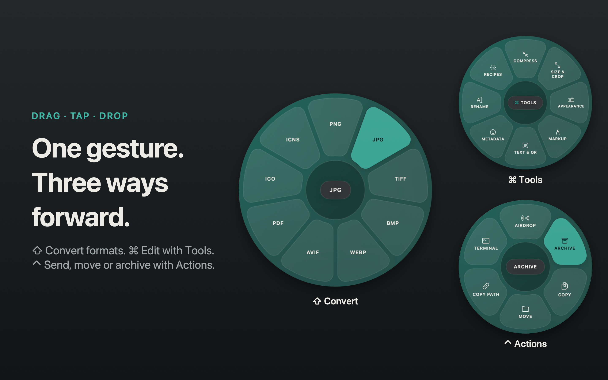
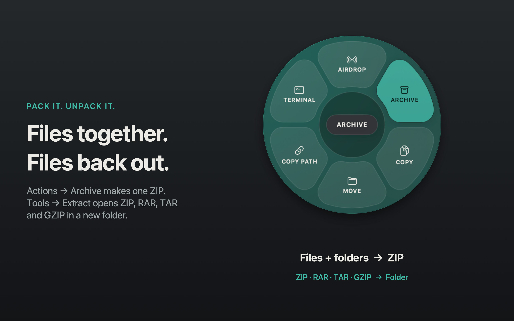
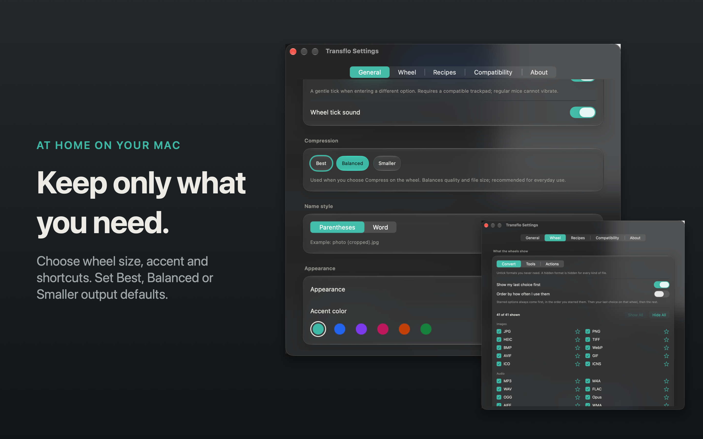
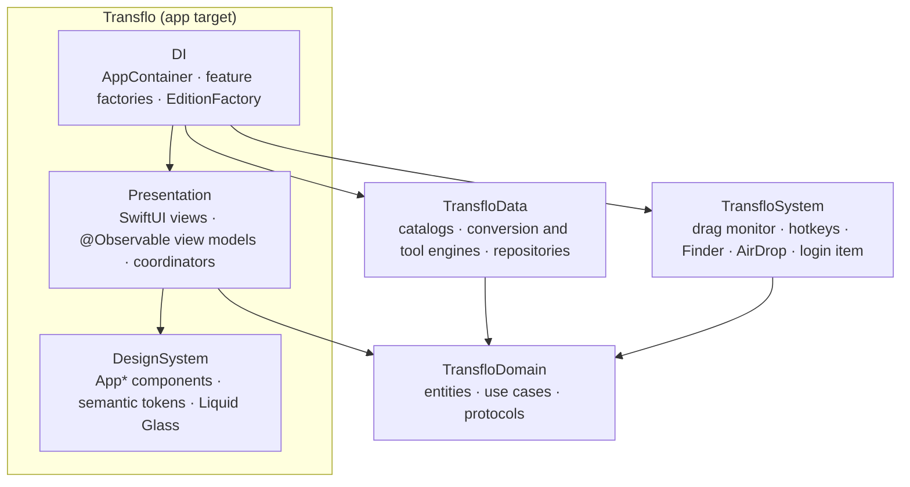

<p align="center">
  
</p>

<h1 align="center">Transflo</h1>

<p align="center">
  <strong>Your files, transformed at your cursor.</strong><br>
  Drag a file, tap a key, drop it on the wheel: convert, edit or send it without opening another app.<br>
  Free and open source for macOS. File processing runs on your Mac.
</p>

<p align="center">
  <a href="https://transfloformac.ali-fayed.com"></a>
  <a href="https://github.com/Ali-Fayed/transflo/releases/latest"></a>
</p>

<p align="center">
  
  
  
  <a href="LICENSE"></a>
</p>

<p align="center">
  <a href="https://transfloformac.ali-fayed.com">Website</a> ·
  <a href="#install">Install</a> ·
  <a href="#how-it-works">How it works</a> ·
  <a href="#what-it-can-do">Features</a> ·
  <a href="#private-by-design">Privacy</a> ·
  <a href="#how-its-built">How it's built</a>
</p>

<p align="center">
  <br>
  <sub>Want it sharper? <a href="https://github.com/Ali-Fayed/transflo/raw/main/docs/media/transflo-promo.mp4">Download the 1080p video</a> (16 MB). Explore the feature designs below, made with the current app UI.</sub>
</p>

## Features at a glance

- **Convert without opening another app:** 288 conversions across images, audio, video, documents, PDF, spreadsheets, subtitles and archives.
- **Finish small edits quickly:** 31 tools for cropping, resizing, backgrounds, markup, PDF pages, media, metadata and filenames.
- **Read and improve images on-device:** OCR for images and scanned PDFs, 2× upscaling, plus image descriptions and Smart Rename on supported Apple Intelligence Macs.
- **Run your own Recipes:** chain steps once, then choose the saved recipe from Tools. Watch folders can run it automatically.
- **Pack and unpack:** archive selected files and folders into a ZIP, or extract ZIP, RAR, TAR and GZIP into a new folder.
- **Keep the wheel focused:** related tools share compact groups; choose your wheel size, accent, shortcuts and visible options.
- **Work locally:** no account or file uploads for processing. English and Arabic, light and dark, keyboard controls and VoiceOver.

## Three wheels, one gesture

<p align="center">
  
</p>

---

## How it works

1. **Start dragging** any file (or a few) in Finder.
2. **Tap a key** while you drag. A wheel opens right under your pointer:
   - **⇧ Shift:** Convert
   - **⌘ Command:** Tools
   - **⌃ Control:** Actions
3. **Drop on a petal.** Conversions and edits create a new result beside the original. The wheel folds into a small disc that fills as the job runs, then ticks when it's done (or shakes with the reason if it fails); click it to reveal the file. Rename and Move apply the requested change to the selected files.

The wheel stays open after you let go of the key, so take your time. Tap another key to switch wheels. Only options that work for **every** file you're dragging are shown.

> Prefer the keyboard? Select files in Finder and press **⌥⌘Return**. Use the arrows to pick, **Return** to apply and **Esc** to cancel. Or right-click and choose **Quick Actions › Open in Transflo**.

## What it can do

### ⇧ Convert: 288 conversions
| Family | Formats |
|---|---|
| Images | JPG · PNG · HEIC · WebP · AVIF · TIFF · BMP · GIF · SVG (in) → PDF |
| Icons | Any image → ICO (Windows) · ICNS (macOS), and back to PNG / JPG |
| Audio | MP3 · M4A · WAV · FLAC · OGG · Opus · AIFF · WMA |
| Video | MP4 · MOV · MKV · WebM · AVI · WMV · animated GIF, plus audio extraction to MP3 |
| Documents | PDF ↔ DOCX · Pages · Markdown · TXT · EPUB · HTML · RTF / RTFD · text clippings |
| PDF | → DOCX · Pages · PPTX · XLSX · EPUB · Markdown · TXT · JPG / PNG (every page) |
| Spreadsheets | XLSX · ODS · CSV · TSV (XLS in) → PDF |
| Slides | PPTX / PPT → PDF · JPG · PNG |
| Subtitles | SRT ↔ VTT → TXT |
| Archives | ZIP · TAR · GZIP (RAR in) |

### ⌘ Tools: 31 of them

The wheel groups related tools under Size & Crop, Appearance, Markup, Text & QR, Metadata, Rename,
Arrange, Timeline and Audio. Hover over a group while dragging, or click it, then choose the tool.
Back returns to the groups after a one-second hover and gives you another second to move before a
new group opens automatically. Clicks and keyboard choices work immediately. A group with only one
available tool becomes a direct option. Recipes always opens your saved, compatible recipes, even
when there is just one; it stays hidden when none can run. Long recipe lists can still use More.
All 31 tools remain available through these groups and direct options.

<p align="center">
  
</p>


| | |
|---|---|
| **Images** | Compress · Resize · Crop · Rotate & flip · Adjust (light, color and detail) · Annotate (boxes, arrows, pen, text) · Redact · Remove background · Add background · Read QR / barcode · Images → PDF · Collage |
| **Video & audio** | Compress · Resize · Crop · Trim · Change speed · Split · Merge · Snapshot a frame · Mute · Normalize loudness · Bleep · Stereo → mono |
| **PDF** | Compress · Rotate · Split · Merge · Reorganize pages · Extract pages · Annotate · Redact (the covered text is really gone) · Read QR |
| **On-device intelligence** | Extract text (OCR, also from scanned PDFs) · Upscale 2× (MetalFX) · Describe image (alt text) and Smart Rename, on macOS 26 with Apple Intelligence. Nothing leaves your Mac |
| **Archives** | Extract ZIP, RAR, TAR and GZIP into a new folder beside the original; existing files stay untouched |
| **Metadata & names** | Edit metadata (title, author, comment) · Remove metadata (images, audio, video, PDF) · Rename any files with a pattern (`{name}`, `{n}`) |

Twenty-six tools open focused editors; Mute, Extract Text, Describe Image, Upscale and archive Extract run straight away. Smart Rename shows its suggested names for you to edit before anything is renamed. Merge and Images to PDF support source ordering, background removal previews its result, audio tools offer channel and loudness controls with audition, and metadata tools let you inspect the source fields. Crop offers aspect ratios, exact pixel dimensions, X/Y positioning and centering. Rotate offers quarter turns and image/video mirroring. Add Background offers canvas ratios, solid colors, gradients, padding, corners and shadows. Adjust offers exposure, brightness, contrast, highlights, shadows, warmth, tint, saturation, vibrance, sharpness, noise reduction and vignette, with original comparison and individual resets.

The [tool editor inventory](docs/features/tool-editor-options.md) lists every editor’s controls and format-specific behavior.

Compression opens a per-drop editor with quality presets, a maximum size per file, or a percentage of each original file's size. Images also offer an explicit maximum long edge. Very small targets may require lower quality or dimensions, and some cannot be reached. PDF compression uses the macOS reduction filter rather than an exact size target. Animated GIFs are compressed frame by frame with a shared palette, fewer colors and, at stronger levels, smaller frames.


### Saved Recipes and watch folders

Create a Recipe in **Settings → Recipes** by chaining conversion, resize, compression, metadata removal or rename steps. For example, turn photos into JPG, resize them for the web and remove metadata in one run. Open **Tools → Recipes** to use a saved recipe; the entry appears when a compatible recipe is available. Watch folders apply a saved recipe to arriving files, and Shortcuts, Spotlight and Siri can start the same workflows.

<p align="center">
  
</p>

### ⌃ Actions
<p align="center">
  
</p>

**AirDrop** · **Archive**: pack selected files and folders into one ZIP beside the first selected item · **Copy** (paste the files anywhere) · **Move**: to one of your recent folders or a new one · **Copy Path** (hold ⌥ for `~/…`) · **Terminal**: open the folder in Terminal, iTerm, Ghostty or Warp.

## Made to feel at home on your Mac
<p align="center">
  
</p>

- **Liquid Glass** on macOS 26, a frosted look on macOS 14–15, or solid surfaces if you prefer.
- **Make it yours:** choose an accent color and wheel size, pick which key opens which wheel, and set your own global shortcut. Optional tick sounds and trackpad haptics respond when entering a different wheel option; each has its own saved switch. Preferences are saved across launches.
- **One Settings window:** General holds appearance, input controls and shared output defaults; Wheel controls sizing and visibility; Recipes holds saved workflows and watch folders; Compatibility shows the available conversions; About contains version, updates and help.
- **Only what you use:** in Settings › Wheel, untick any format, tool or action you never need. Keep five or six per wheel and every petal gets bigger and easier to hit.
- **General › Compression:** choose Best, Balanced or Smaller, and how edited files are named. Short Settings tabs fit their content; longer tabs scroll.
- **Getting Started:** a five-page tour introduces the menu bar, wheels, grouped tool selection, Recipes and shortcuts. Replay it from the menu bar.
- **Updates:** Transflo checks once a day and sends a notification when a new version is out. **Check for Updates…** in the menu bar or Settings checks right away. The DMG/Homebrew edition opens the GitHub release (or run `brew upgrade --cask transflo`); the App Store edition opens the App Store, which installs it. Turn the daily check off in Settings › About.
- **Jobs window** (⌘J) to follow, cancel or reveal everything you've run. Long jobs send a notification.
- **English and العربية**, with full right-to-left layout, light and dark.
- **VoiceOver:** petals are buttons with hints, and finished jobs are announced. Reduce Motion is respected.


Browse the [current app captures](docs/screenshots) for individual screens in English, Arabic, light and dark.

## Private by design
Transflo does not upload files for processing. AirDrop shares files only when you select that action. Conversions run on your Mac with Apple's frameworks and a bundled, LGPL-licensed FFmpeg. There are no accounts and no analytics. The only network request is the update check: once a day (unless you turn it off in Settings › About) and whenever you choose **Check for Updates…**, Transflo asks GitHub, or the App Store in the App Store edition, for the latest version number. Nothing about you or your files is sent.

macOS may request permissions for:
- **Automation › Finder**, when you first use the keyboard shortcut (to read your selection).
- **Automation › Pages / Keynote / Numbers**, only if you convert iWork files.
- **Notifications**, for job completion alerts.
- **Folder access**, when opening or saving files in protected locations such as Desktop or Documents.

## Install
Everything about Transflo, including the privacy policy and support, is on **[transfloformac.ali-fayed.com](https://transfloformac.ali-fayed.com)**.

**Homebrew**
```bash
brew install --cask ali-fayed/transflo/transflo
```

**Or download** the latest `Transflo-<version>-arm64.dmg` from [Releases](https://github.com/Ali-Fayed/transflo/releases/latest), open it, and drag Transflo to Applications.

Releases are signed with Developer ID and notarized by Apple, so they open like any other Mac app.

**Mac App Store** (coming soon): a sandboxed edition with the same wheels. Because of the App Store's sandbox it asks once per folder before saving next to your files, and it leaves out the Finder-selection shortcut (use **Open in Transflo** from the right-click menu instead), Pages/Keynote/Numbers conversions and the Terminal action. Transflo tells you when an update is out; the App Store installs it.

Requires **macOS 14 Sonoma or later** on **Apple silicon**.

## FAQ
**Does it replace my files?** Conversions and edits create new files and avoid overwriting existing paths, such as `photo.png`, `photo (compressed).jpg` or `photo 2.png`. Rename changes the selected filenames; Move relocates the selected files.

**Where did the icon go?** Transflo lives in the menu bar. The first launch opens Getting Started; after you finish it, the app starts from the menu bar. Click its icon for Jobs, Settings, Getting Started and Check for Updates.

**Can I drop many files at once?** Yes. The wheel shows only what works for all of them, and the job processes them one by one with a single progress bar.

**Is it really free?** Yes: MIT-licensed, with no limits, trials or accounts.

## How it's built
Transflo is a native Swift 6 app: SwiftUI for every screen, AppKit where macOS needs it (floating panels, drag
observation, menu bar), and three local Swift packages that keep the logic independent of the UI.



| Layer | Responsibility |
|---|---|
| `TransfloDomain` | Pure Swift: formats, wheel options, jobs, typed `JobError`s, use cases and the protocols everything else implements. No AppKit. |
| `TransfloData` | The JSON conversion and tool catalogs, the engines (ImageIO, AVFoundation, PDFKit, Vision, FFmpeg, iWork), and UserDefaults repositories. |
| `TransfloSystem` | macOS integration: polling the drag pasteboard, Carbon hotkeys, Finder selection, AirDrop, login items, notifications, security-scoped folder access. |
| `Transflo` | MVVM presentation with coordinators, a token-based design system (every screen composes `App*` components), and the composition root. |

**A drop, end to end.** `DragMonitor` notices a file drag and the wheel key → `WheelCoordinator` asks
`ResolveWheelOptionsUseCase` what applies to every dragged file (the catalog, filtered by Settings › Wheel) →
the petal you drop on becomes a job in `JobCenter`, which runs it with bounded concurrency → the engine writes to
private staging and publishes the result next to the original without ever replacing a file → the result disc
shows progress, then ✓ or ✕.

**Named patterns.**
- **Strategy:** conversion and tool engines; the result disc behind `JobHUDPresenting`.
- **Registry:** `ConversionCatalog`.
- **Decorator:** wheel visibility; App Store folder access.
- **Repository:** settings.
- **Factory:** DI and editions.
- **Coordinator:** wheel, editors, windows.
- **Composite:** the demo video timeline.

All dependencies are passed in through initializers, so every unit is tested with hand-written doubles.

**Engines.** Apple frameworks first; a bundled LGPL-only FFmpeg (built reproducibly from pinned, checksummed
sources) covers what they can't write. It runs as a separate signed helper process with argument arrays, never a
shell. Cancellation reaches every engine, archives are checked against expansion budgets, and documents are parsed
with external entities disabled.

**Concurrency.** Swift 6 strict concurrency, main-actor by default in the app target, typed throws in the engines
and actors where state is shared.

**Two editions, one target.** The `AppStore` build configuration adds the App Sandbox. `AppEdition` lists what each
edition may do, and `EditionFactory` is the single place that acts on it. See [docs/APP_STORE.md](docs/APP_STORE.md).

**Quality and delivery.**
- **Tests:** about 330 package tests, 170 app unit tests and 45 UI tests. UI tests are split into Fast, Extended
  and Marketing test plans, and run in an isolated preferences suite.
- **Checks:** SwiftLint strict (zero warnings), and a secrets scan in CI.
- **Project:** generated with XcodeGen, using Xcode synchronized folders.
- **Release:** a tag starts one pipeline that ships the GitHub DMG and the App Store build in parallel; Homebrew
  follows the DMG.

More detail: [architecture](docs/ARCHITECTURE.md) · [development](docs/DEVELOPING.md) · [releasing](docs/RELEASING.md).

## Build from source
See [docs/DEVELOPING.md](docs/DEVELOPING.md) to build, test and capture screenshots, and [docs/RELEASING.md](docs/RELEASING.md) to cut a release. See the [architecture overview](docs/ARCHITECTURE.md) for the app layers and persistence model.

Changes are welcome: start with [CONTRIBUTING.md](CONTRIBUTING.md). For private vulnerability reports, see [SECURITY.md](SECURITY.md).

## License
Transflo is released under the [MIT License](LICENSE). It bundles FFmpeg (LGPL 2.1+) and a few codec libraries; see [THIRD_PARTY_NOTICES.md](THIRD_PARTY_NOTICES.md) for licenses, sources and the written offer.

Transflo is an independent project and isn't affiliated with Apple.
